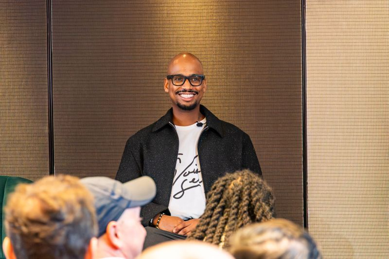
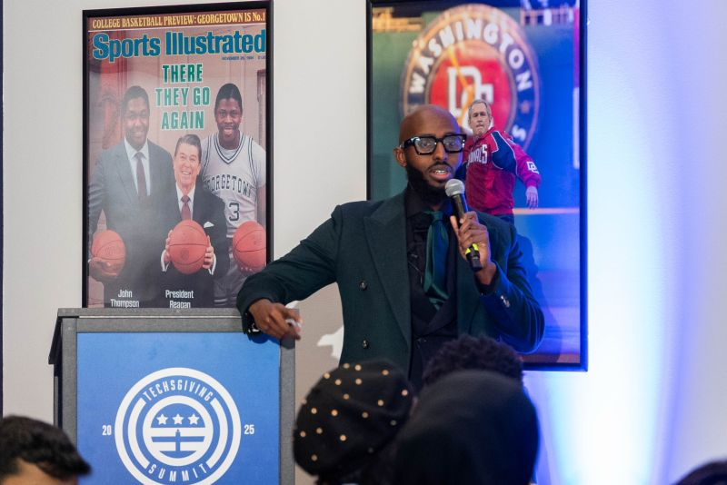
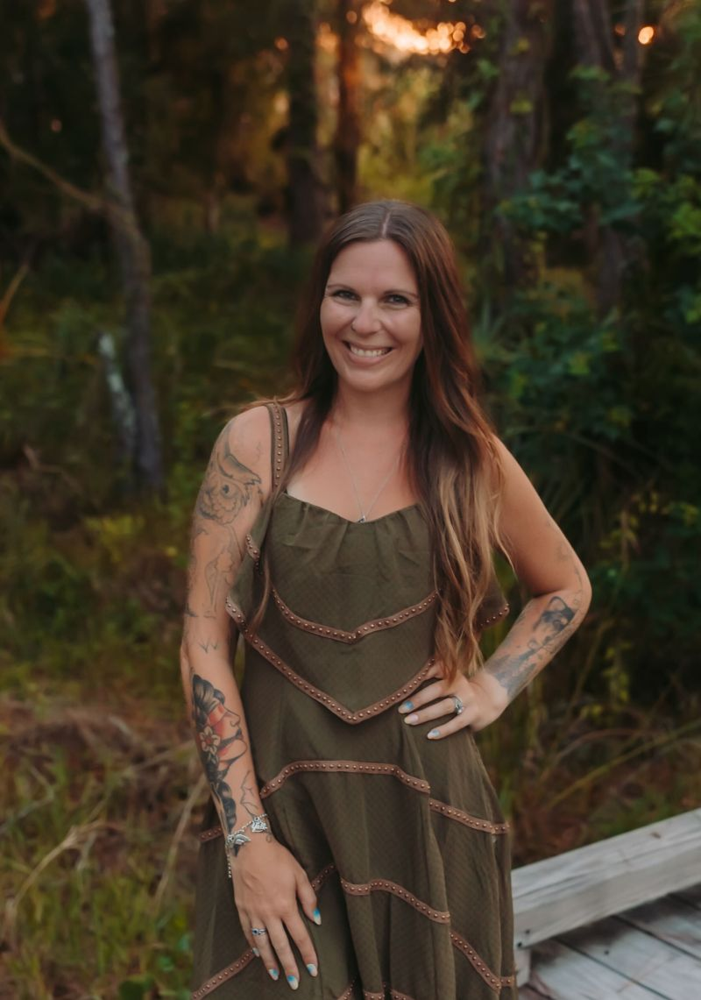
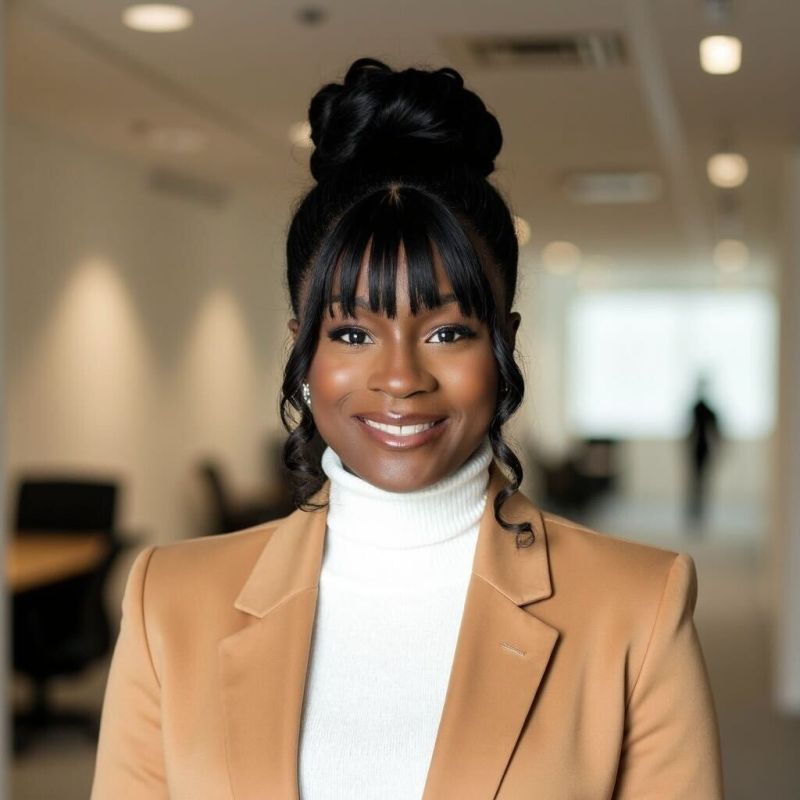
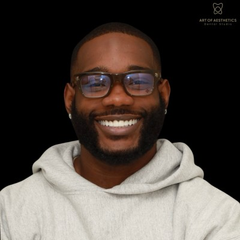

# GRC Engineering Club — Design System

The brand and design system behind [grcengclub.com](https://grcengclub.com), the [claude-grc-engineering](https://github.com/GRCEngClub/claude-grc-engineering) docs, Academy surfaces, slide decks, and merch.

One accent color, dark-mode-only, Inter heavy-weights for display, Lucide line icons, and a voice that says **builder**, not vendor.

---

## What's in this repo

| Folder | What it is |
|---|---|
| [`colors_and_type.css`](colors_and_type.css) | Drop-in CSS variables (`--grc-orange`, `--grc-dark`, `--grc-gray`, `--fg-1`, …) and semantic type rules for `h1`, `h2`, `.eyebrow`, `.lede`. References local Inter. |
| [`fonts/`](fonts) | Vendored Inter `woff2` files (weights 400, 500, 600, 700, 800, 900). No Google Fonts dependency. |
| [`assets/`](assets) | Logo, orange brand mark, leadership headshots, merch product shots. Copy from here; do not recreate. |
| [`preview/`](preview) | Reference cards for colors, type, spacing, components, and iconography. Open any in a browser to see the system applied. |
| [`slides/`](slides) | 12 brand-ready slide templates (Title, Section, Problem, Approach, Stat, Quote, Certification, Roadmap, Code, Comparison, Pillars, Closer). Built on `<deck-stage>` at 1920×1080. |
| [`ui_kits/website/`](ui_kits/website) | Full marketing-site recreation (Home, Academy, Stories, Join, FAQ) as JSX components. |
| [`ui_kits/certplatform/`](ui_kits/certplatform) | Academy cert-platform recreation (Dashboard, Course, Lesson player, Labs, Exam readiness). |
| [`PUBLISHING.md`](PUBLISHING.md) | How to install as a Claude Code skill and how to publish to the Club. |

---

## Core brand rules — do not violate

- **One accent color only: orange `#E8650A`.** No bluish-purple gradients, no multi-color palettes. Orange lives on CTAs, link text, eyebrows, icons, and accent spans like `Club`.
- **Dark mode only.** Page `#0D0D0D`, alt section `#1A1A1A`, cards `#2A2A2A`. Sections alternate page / alt for vertical rhythm.
- **Typography is Inter, heavy weights for display** (800/900). Display headlines use `tracking-tight`. Eyebrows are UPPERCASE orange with wide tracking.
- **Iconography is Lucide line icons** at default stroke. When emphasized, they sit in a `rounded-full bg-orange/10 text-orange` circular well. **No emoji, ever.**
- **Card recipe:** `bg-[#2A2A2A]` + `border border-[#3A3A3A]` + `rounded-xl` + `p-6` + `hover:border-orange/50`. No drop shadows on cards; shadows only on primary CTAs (a warm orange glow).
- **Voice is builder-energy:** direct, imperative, second-person. *"Stop scrolling, start engineering."* *"From checkbox GRC to engineered systems."* Never vendor-speak.

---

## Quickstart — dropping tokens into a new project

1. Copy `colors_and_type.css` into your project's token system.
2. Copy `fonts/` to your static assets and reference `@font-face` via the relative path in `colors_and_type.css`.
3. Use `preview/` as a visual regression baseline while you build.
4. For slide decks, copy a file from `slides/`, swap the content, keep the tokens.

---

## Leadership team

The humans behind the Club. These are the people shaping what ships.

| | Name | Role | Links |
|---|---|---|---|
|  | **AJ Yawn** | Executive Chairman & Founder | [LinkedIn](https://www.linkedin.com/in/ajyawn/) · [GitHub @ajy0127](https://github.com/ajy0127) |
|  | **Abdie Mohamed** | President | [LinkedIn](https://www.linkedin.com/in/abdie-mohamed-3a8684140/) |
|  | **James Tabron, CISSP** | Vice President | [LinkedIn](https://www.linkedin.com/in/jamestabron/) |
|  | **Ashley Pearce** | Head of Career Ops | [LinkedIn](https://www.linkedin.com/in/ashley-pearce/) · [GitHub @ashpearce](https://github.com/ashpearce) |
|  | **Zinet Kemal, M.S.c** | Head of Membership | [LinkedIn](https://www.linkedin.com/in/zinetkemal/) |
|  | **James "JR" Robinson** | Creative Director | [LinkedIn](https://www.linkedin.com/in/james-tr-robinson/) |
|  | **Ethan Troy** | Head of AI Research | [LinkedIn](https://www.linkedin.com/in/ethantroy/) · [GitHub @ethanolivertroy](https://github.com/ethanolivertroy) |
|  | **Dr. Omar Sangurima, CISSP** | Podcast Lead | [LinkedIn](https://www.linkedin.com/in/dromars/) |
|  | **Lauren Alex-Igwe (Nwegbo)** | GRC Events Lead | [LinkedIn](https://www.linkedin.com/in/lauren-alex-igwe-18a66816b/) |
|  | **Nick McLaren** | Head of Community Ops | [LinkedIn](https://www.linkedin.com/in/nmclarencys/) |

Leadership, if you're on GitHub and not listed: open a PR to add your handle.

---

## Licensing

- **Code, CSS tokens, and slide/UI-kit source** in this repo are released under the [MIT License](LICENSE).
- **Brand assets** — the GRC Engineering Club logo, wordmark, orange brand mark, leadership headshots, and merch photography in [`assets/`](assets) — are **not MIT-licensed**. They belong to the individuals and the Club. Do not reuse them outside of work that represents the GRC Engineering Club without written permission.

---

## Join the Club

Everything in this repo is used to run [grcengclub.com](https://grcengclub.com) — a paid membership community for GRC practitioners learning the engineering layer. Weekly private podcast, bi-weekly live Q&A, hands-on AWS compliance labs, mock interviews, career playbooks, and live builder sessions. Details and pricing at [grcengclub.com](https://grcengclub.com).
